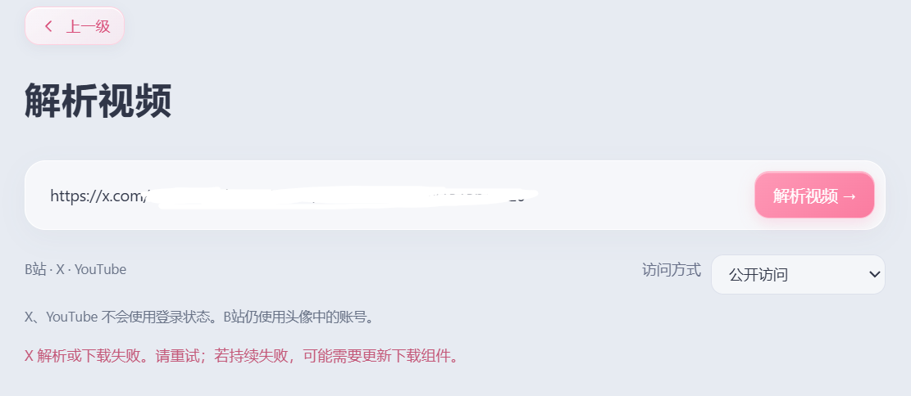
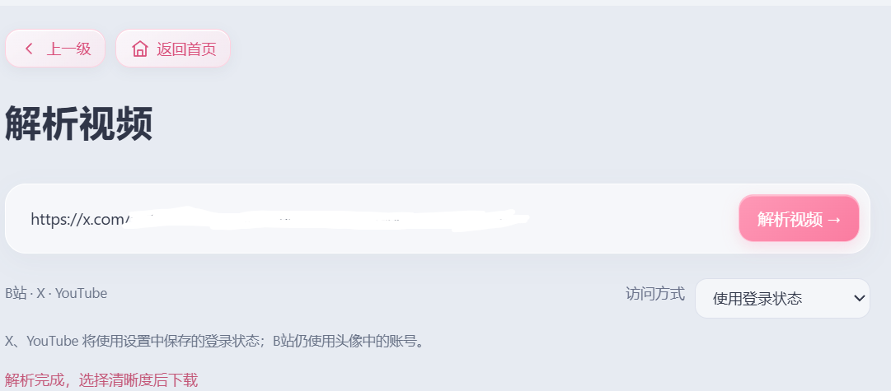
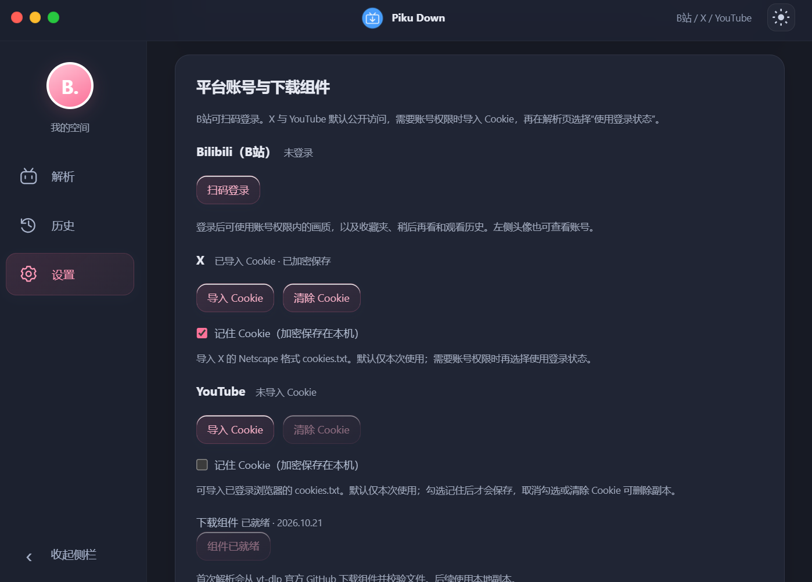
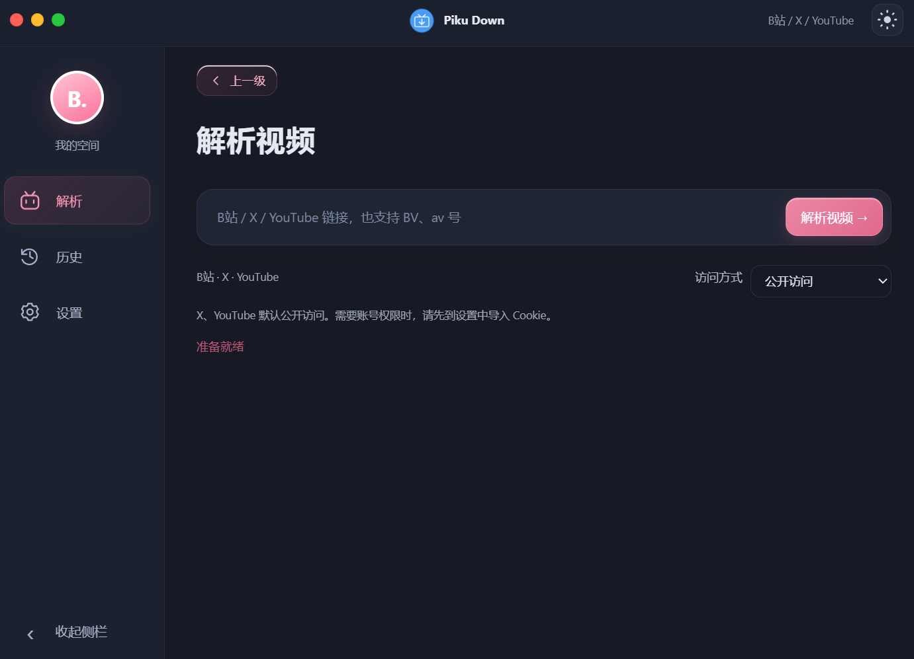

# Piku Down 1.6.1

Windows 视频与音频下载工具，支持 B站、X（Twitter）和 YouTube。提供 x64、x86（ia32）、ARM64 构建及实验性的 Win7 兼容构建。

## 本轮新增

粘贴 X 帖子、YouTube 视频或 Shorts 链接即可解析，选择画质后保存为 MP4，也支持 M4A 和 MP3。X 多视频帖子可逐段选择。YouTube 播放列表参数会被移除，每次只处理当前视频；暂不下载进行中的直播。

解析页默认“公开访问”，X 与 YouTube 不会使用已保存的 Cookie。需要账号权限时，先在设置中导入对应平台的 Netscape 格式 cookies.txt，再选择“使用登录状态”重新解析。X 与 YouTube 目前只通过 Cookie 导入使用账号权限。B站账号也集中显示在设置中，可扫码登录或退出；左侧头像保留快捷入口。

导入时只保留对应平台的有效域名 Cookie，默认仅在本次运行的内存中使用，退出软件后需重新导入。只有明确勾选“记住 Cookie（加密保存在本机）”后，才会保存加密副本。取消勾选会立即删除磁盘副本并保留本次使用；“清除 Cookie”会同时清除当前状态与已保存副本。下载期间需先完成或取消任务，才能更改保存方式。解析及下载交给 yt-dlp 的临时 Cookie 文件位于应用数据目录，任务结束时删除，异常退出后下次启动会清理。浏览器导出的原始文件请自行保管或删除。

首次使用 X 或 YouTube 时，应用从 [yt-dlp 官方发行页](https://github.com/yt-dlp/yt-dlp/releases/tag/2026.10.21) 下载当前架构的组件，校验固定 SHA-256 后才会执行；后续直接使用本地副本。YouTube 使用 Electron 自带的 Node 运行环境处理挑战脚本，无需额外安装 Python 或 Deno。实现依据见 [yt-dlp EJS 说明](https://github.com/yt-dlp/yt-dlp/wiki/EJS)。视频合并保留原流；M4A 在源音轨不是 AAC 时会转码，MP3 使用 320 kbps。


Cookie 档案由使用者自行汇出与提供。程式在本地使用该档案进行需要登入的下载操作，不会主动上传 Cookie 至开发者伺服器。请妥善保管 Cookie 档案，避免分享给他人。

本节指 X / YouTube 的导入 Cookie。导入、格式校验、域名筛选及保存都在本机完成；仅由 yt-dlp 在访问对应平台的必要请求中按 Cookie 域名规则使用，不会上传文件至开发者服务器或无关服务。

## 1.6.1 更新

- B站 DASH 视频与音频同时下载，合并两路进度，每 100 ms 更新界面。任一路失败或取消时，会中止另一条流并等待文件关闭，再清理任务。
- 下载使用 1 MiB 写入缓冲；连续 15 秒未收到数据时切换备用源，这是无数据停滞超时，不限制总下载时间或最低速度。合并时移除 `faststart` 的额外全文件重写，同分区优先通过硬链接保存；跨分区先复制到目标磁盘的独立暂存位置，完整复制后才发布正式文件，同名竞争时也不会覆盖。复制失败或取消会清理本次暂存文件。
- B站画质接口结果在内存中缓存 60 秒，退出登录或账号状态改变时清空。DASH 画质从同一次响应读取，减少重复请求。
- 窗口拖动通知按约 60 fps 合并发送。X / YouTube 下载流程及 IPC 接口保持不变。

1.6.1 的自动测试与本地传输检查已通过；真实 B站片源、安装升级及各系统的完整回归仍待测试。以下保留 1.6.0 的实测记录，避免把旧版本结果当作新版本验收。

## Cookie 导入教程（X / YouTube）

### 1. 在浏览器中登录

在 Chrome 中打开 [X](https://x.com/) 或 [YouTube](https://www.youtube.com/)，登录你要使用的账号。先确认该账号能在网页上观看目标视频。两个平台的 Cookie 需要分别导出、分别导入。

B站继续使用软件中的扫码登录，不需要按本节导入 Cookie。

### 2. 导出当前网站的 Cookie

安装 [Get cookies.txt LOCALLY](https://chromewebstore.google.com/detail/get-cookiestxt-locally/cclelndahbckbenkjhflpdbgdldlbecc)，然后回到已经登录的 X 或 YouTube 页面。

1. 点击 Chrome 工具栏的扩展图标，打开 **Get cookies.txt LOCALLY**。
2. 确认当前网站是 `x.com` 或 `youtube.com`。使用哪个账号下载，就在该账号登录的浏览器窗口导出。
3. 在 **Export Format** 中选择 **Netscape**，点击 **Export** 或 **Export As** 导出**当前网站**的 Cookie，保存为 `cookies.txt`。不要点击 **Export All Cookies**，也不要选择 JSON 格式。仅修改文件扩展名不能把 JSON 转成 Netscape 格式。
4. 可以分别命名为 `x-cookies.txt`、`youtube-cookies.txt`，避免选错文件。

### 3. 导入 Piku Down

1. 打开软件的**设置 → 平台账号与下载组件**。
2. 在 **X** 或 **YouTube** 对应区域点击**导入 Cookie**。
3. 默认不勾选**记住 Cookie（加密保存在本机）**，导入后仅本次运行可用。需要下次启动继续使用时再勾选；之后可取消勾选删除保存副本，或点击**清除 Cookie**移除全部软件状态。
4. 选择刚刚导出的 `.txt` 文件。显示**已导入 Cookie · 仅本次使用**或**已导入 Cookie · 已加密保存**后，返回解析页。这个状态只表示 Cookie 已导入，实际访问权限仍以网站和账号为准。
5. 把**访问方式**切换为**使用登录状态**，重新粘贴视频链接并解析，然后选择画质下载。

导入 Cookie 后继续使用“公开访问”，不会带上账号 Cookie。切换访问方式后要重新解析，不能直接沿用之前的失败结果。

### 什么时候需要 Cookie

是否需要登录，取决于贴文可见性、平台限制及当时的提取方式，不能只凭“敏感内容”标签判断。能够公开访问的内容可先使用“公开访问”；平台要求账号权限时，才导入 Cookie 并选择“使用登录状态”。软件按账号已有权限访问，不绕过平台的存取限制。

YouTube 的 Cookie 用于访问账号原本就能观看、但需要登录的内容，例如年龄限制、获准观看的私人视频或已加入对应频道会员的专属视频。普通公开视频通常不需要。导入 Cookie 不会获得会员资格或额外权限，也不能绕过付费或 DRM；这些账号场景仍待实测。参见 [yt-dlp 的 YouTube Cookie 说明](https://github.com/yt-dlp/yt-dlp/wiki/Extractors#exporting-youtube-cookies)。

2026-10-25 的实测中，一个 X 敏感内容样本在导入 Cookie 并选择“使用登录状态”后可下载，同一内容在“公开访问”下失败。这是该账号、片源和当时提取方式的结果，不代表所有敏感内容都必须登录。

### 常见问题

| 情况 | 处理方式 |
| --- | --- |
| 已导入 Cookie，但敏感内容仍提示解析或下载失败 | 检查访问方式是否为“使用登录状态”，然后重新解析；确认浏览器中的同一账号能观看该视频。 |
| 提示请选择 Netscape 格式 | 在扩展中选择 Netscape 后重新导出，不能直接导入 JSON。 |
| 提示没有找到 X 登录状态 | 在已经登录的 `x.com` 页面重新导出当前网站的 Cookie，避免从退出登录页或其他网站导出。 |
| 以前可用，现在失败 | Cookie 可能已经过期或被网站撤销。重新登录、导出并导入，再重新解析。 |
| 网页本身也看不了 | 检查账号权限、视频是否删除及地区限制；导入 Cookie 不会增加账号权限。 |

Cookie 相当于登录凭证。不要把导出文件、Cookie 值或未遮挡的截图上传到 GitHub、问题反馈或聊天中。扩展只需导出当前网站；软件会过滤其他域名，默认仅在本次运行使用，明确勾选记住后才加密保存。导入完成后可自行删除原始导出文件。设置中的**清除 Cookie**只清除软件保存的该平台状态，不会退出浏览器账号，也不会删除已下载的视频。

### 开发时的凭证处理

生产代码不记录 Cookie 内容，不把原始提取器诊断直接传给界面。传给 yt-dlp 的是临时文件路径，使用参数数组及 `shell: false` 启动进程，Cookie 内容不会拼进 Shell 命令。反馈问题时请只提供错误提示、软件版本和可公开分享的视频链接，不要附带 cookies.txt、Cookie 值或未遮挡的截图。

## 测试结果（Windows 10 / 11）

记录日期：2026-10-25；当前版本：**1.6.1**。此前 **1.6.0-preview.4（p4）** 已完成测试并发布为 1.6.0；其公开样本、账号与截图记录保留在下方，尚未全部在 1.6.1 重跑。

本轮测试机为 **Windows 11 Pro for Workstations x64，版本 10.0.26300**。Windows 10 使用同一套现代版 x64 构建，但本轮没有 Windows 10 独立实机记录，因此仍标注为**待测试**。

### 1.6.1 自动检查（Windows 11 x64）

| 项目 | 结果 | 验证方式与范围 |
| --- | --- | --- |
| 单元测试 | 84 项通过 | 包含并行传输、聚合进度、缓存失效、停滞重试、取消清理、跨分区半成品隔离、磁盘满、同名竞争与暂存清理等。 |
| 界面流程 | 3 组通过 | 原有操作、游客模式与外部平台设置的独立界面检查。 |
| Electron 传输管线 | 现代与兼容运行时通过 | Electron 42 与 Electron 22 在同一台 Windows 11 电脑上连接本地测试服务器，检查并行、备用源、取消与文件关闭；不代表 Win7 实机结果。 |

真实 B站 CDN 下载速度尚未测量，不宣称固定的提速比例。1.6.1 的安装版、便携版及各架构构建仍需按下方项目实机验证。

### 1.6.0 Windows 11 x64 实测记录

| 项目 | 结果 | 验证方式与范围 |
| --- | --- | --- |
| 单元测试 | 47 项通过 | 视频链接、选流、账户列表、任务清理与取消、网络兼容及 Cookie 处理等自动测试。 |
| 界面流程 | 通过独立界面测试 | 原有操作、游客模式、平台设置、Cookie 导入、默认仅本次使用、记住与取消记住等流程；不等同于真实账号的完整实机回归。 |
| X 公开视频 | 联网样本通过 | 一般视频解析、MP4、M4A、MP3 输出；多视频帖子已识别多个片段并下载其中一个。 |
| YouTube 公开视频 | 联网样本通过 | 视频解析、MP4、M4A、MP3 输出，并读取生成视频的分辨率与帧率。 |
| X 登录状态下载 | 实测通过一个样本 | 一个敏感内容样本使用导入的 Cookie 可下载，公开模式下失败；不代表所有敏感内容都需要 Cookie。 |
| Cookie 默认暂存与可选保存 | 自动测试通过 | 默认只在本次运行使用；明确记住后加密保存；取消记住或清除时删除副本，无法解密时也可删除。 |
| 凭证保护 | 自动测试通过 | 提取器错误过滤、Cookie 内容不进入命令参数、Shell 字符按普通参数传递，以及公开模式不读取 Cookie。 |
| 打包检查 | 五组构建通过 | 已核对包内源码一致性、PE 架构、媒体组件及体积；构建通过不代表目标系统或架构已实机测试。 |

p4 已完成当轮验收；1.6.0 调整版本号与说明后重新构建及验证。此历史记录不代表 1.6.1 已完成全部回归，未覆盖范围仍列于下方。

### 界面与实测截图

X 同一敏感内容样本：公开访问失败，导入 Cookie 并选择“使用登录状态”后解析成功。是否需要登录仍取决于内容可见性、账号权限与当时的提取方式。





平台账号设置：B站扫码登录，X / YouTube 导入 Cookie，并提供可选加密保存和清除入口。



解析页默认公开访问，可切换访问方式。



### 待测试项目

- Windows 10 x64 独立实机运行。
- Windows 10 x86（ia32）、Windows 10 / 11 ARM64，以及 Win7 x86 / x64 实机运行。
- 安装、覆盖升级、卸载及不同系统上的完整启动流程。
- B站真实扫码登录、账号画质权限及联网下载回归。
- 1.6.1 的 B站 DASH 并行下载、真实 CDN 备用源与跨磁盘保存；跨分区回退目前仅通过模拟文件系统验证。
- 1.6.1 的 X / YouTube 公开与登录状态下载回归。
- YouTube 需要账号权限的内容、Shorts，以及其他账号和地区限制场景。
- X 多视频帖子的其余片段逐个下载，以及更多不同可见性内容。

### 系统与架构状态

| 目标系统 / 架构 | 状态 | 说明 |
| --- | --- | --- |
| Windows 11 x64 | 部分功能已验证 | 已有结果与待测范围见上表。 |
| Windows 10 x64 | 待测试 | 现代版 x64 包已编译，尚无该系统的独立实机记录。 |
| Windows 10 x86（ia32） | 待测试 | 已编译及静态核对，尚未在 32 位系统实机验证；不列为 Windows 11 系统目标。 |
| Windows 10 / 11 ARM64 | 待测试 | 已编译及静态核对；FFmpeg 通过 x86 模拟运行，尚未在 ARM64 实机验证。 |
| Win7 x86 / x64 | 待测试 | 已编译及静态核对；保留 B站功能，X / YouTube 暂不支持。 |

Win7 包沿用 Electron 22 和旧版 FFmpeg。当前 yt-dlp Windows 发行版要求 Windows 10+，其 YouTube JS 运行环境也超出旧 Electron 的能力，因此不会在 Win7 包里显示可用的新下载功能。

在开发环境运行全部架构构建：

~~~powershell
node scripts/build-all.cjs
~~~

产物形式沿用原项目 Release：Setup EXE 为安装版，普通 EXE 为免安装版，ARM64 另提供 ZIP。x86、ARM64 和 Win7 产物标记为 `untested`，表示目标系统或架构尚待实机测试。独立界面检查可运行 `pnpm exec electron test/ui-harness.cjs --external-fixture`；联网检查使用 `pnpm exec electron test/external-smoke.cjs 视频链接 --download`，只使用公开访问，不读取个人账号。

## B站使用

可以不登录直接使用。游客启动时底部会显示 5 秒提示“B站未登录，部分画质可能不可用”；账号画质以 B站实际权限为准。需要账号功能时，可点击头像扫码登录。粘贴视频链接、BV/av 号或 b23 短链接，选择分 P、画质及保存目录即可下载。支持大封面预览、下载历史、收藏夹、稍后再看与观看历史。

视频支持账号权限内的 4K、HDR 及平台实际提供的高帧率视频流。合并采用原流复制，不补帧、不转换为 SDR。接口画质名称不作为帧率上限；远程帧率检测失败时按接口信息选流。仅音频下载支持 M4A 和 MP3（320 kbps 转码，不会提高源音质）。

支持取消下载和清理当前任务源文件；不会删除预先存在的文件。清空下载历史不会删除完成的视频。

## 外观

自绘标题栏、左侧窗口按钮、可收缩侧栏、深浅色主题、自定义壁纸及模糊、纯色背景。窗口默认 940 × 680，可调整大小。

## 开发与打包

需要 Node.js 22+、pnpm 及下载 Electron/FFmpeg 的网络连接。

```powershell
pnpm install
pnpm exec install-electron
pnpm start
pnpm test
pnpm dist
```

允许 Electron 和 ffmpeg-static 所需的安装脚本。构建产物在 dist：Piku-Down-Setup-1.6.1-x64.exe 为安装版，Piku-Down-1.6.1-x64.exe 为便携版。

单元测试保留在 test，覆盖登录检查、视频标识解析、账户列表、选流、音频编码参数及取消下载清理。真实扫码、账号画质权限及联网下载需人工验证。

## 数据与限制

Cookie、设置、壁纸与下载历史只保存在本机应用数据目录（沿用 bili-desktop 配置目录）；退出登录清除登录会话。不会向第三方服务上传账户数据。

可用画质取决于片源和账号权限，无法绕过会员、付费或 DRM 限制。平台接口、地区限制或风控可能影响功能。仅保存你有权下载的内容。

## 1.5.0 更新

- 移除模拟登录、模拟 API、本地测试媒体替换、截图和内嵌测试执行入口。
- 主窗口及登录窗口禁用开发者工具，主窗口移除二维码专用桥接方法。
- 打包排除测试脚本，独立单元测试保留在源码中。
- 侧栏小电视去掉嘴巴，眼睛向下调整。

图标源图与多尺寸资源位于 resources，生成脚本在 scripts。作者：by @灵眸闪熠。

新增“上一级”页面返回按钮。从账户列表进入解析后可返回列表，保留当前收藏夹、已加载内容和滚动位置。

## 1.5.0 动画与性能

移除解析、历史和设置页的英文小标题、说明文字及解析页功能介绍区。月亮使用实心 SVG。窗口壳正常跟随系统拖动，内部内容通过阻尼弹簧滞后并回弹；账户卡片打开和关闭均有非线性回弹。

设置中的粉色滑动开关启用性能模式：立即取消 JS 动画，停用 CSS 动画、过渡、拖尾、悬停位移与背景/玻璃模糊。设置会持久保存，登录窗口继承该偏好。系统“减少动画”偏好也会停用动态效果。

## 系统与架构

| 构建 | 系统目标 | 媒体工具 |
| --- | --- | --- |
| x64 | Windows 10/11 x64 | x64 FFmpeg |
| ia32（x86） | Windows 10 x86/x64 | x86 FFmpeg |
| ARM64 | Windows 10/11 ARM64 | x86 FFmpeg，经系统模拟运行 |
| Win7 ia32 / x64 | Windows 7 SP1 及以上，实验性兼容包 | 较旧的 x86 FFmpeg |

现代包固定 Electron 42.11.16；Win7 包单独使用 Electron 22.3.27，适配旧版 Chromium 网络请求 API，强制性能模式并移除背景/玻璃模糊。Win7 兼容包基于已停止维护的运行时，不承诺与现代版相同的安全更新或效果；尚未在 Win7 真机验证扫码、证书、下载及媒体工具的完整兼容性。ARM64 界面为原生架构，媒体处理不是 ARM64 原生执行，尚未进行 ARM64 真机验证。

构建机器使用现代 Windows 和 Node.js 22.12+。在项目目录运行：

~~~powershell
pnpm dist          # x64
pnpm dist:x86      # 32 位 x86
pnpm dist:arm64    # ARM64，媒体组件由系统模拟
pnpm dist:win7     # Win7 32 位精简兼容包
pnpm dist:win7:x64 # Win7 64 位精简兼容包
~~~

Win7 产物在 dist/win7，其余在 dist。文件名包含架构，不会相互覆盖。构建会下载官方 Electron 与 ffmpeg-static 发布资产，检查 FFmpeg 的 PE 架构，并只在目标包中替换媒体二进制，不更改本机开发依赖。可以在 GitHub Actions 的 Build Windows packages 工作流手动生成各架构产物。

每个安装后的应用目录上限为 500,000,000 字节，构建检查预留约 1 MB 签名余量；只打包简体中文与英文语言资源及运行所需图标。视频文件和自行保存的壁纸、缓存不计入应用本体限制。便携版运行时解压也会产生临时文件，不能以安装包文件大小推算运行磁盘需求。

单元测试使用 pnpm test。独立 UI 验证程序位于 test/ui-harness.cjs，仅供开发，不会随安装包发布，也不在应用中暴露任何测试参数入口。

## 1.5.1 x64 预览

窗口移动时只让按钮等交互控件产生轻微弹性滞后；背景、标题、输入区域、封面和面板保持固定。账户菜单使用统一线宽的 SVG 收藏星标、时钟、播放历史图标。本轮仅生成 x64 包，其余架构保留 1.5.0，等待界面确认后再同步。

1.5.1 x64 预览同时加入游客模式：解析、下载、本地历史与设置无需登录；收藏夹、稍后再看及 B站观看历史仍需登录。关闭扫码窗口会返回软件，不再退出应用。

## 1.5.2 拖拽手感优化（仅 x64 预览）

拖拽弹性独立开关默认关闭，可在设置中开启。性能模式或系统减少动态效果偏好会暂停该效果。背景、标题栏、输入区、面板和侧栏收起按钮完全固定，仅交互按钮产生最多约 10 像素的轻微滞后，并按返回按钮、侧栏按钮和主区按钮使用不同幅度。

移除主进程固定 12 ms 节流，用原生移动事件及合并更新传递最新位置；前端按显示刷新使用 requestAnimationFrame，不设固定 60fps 上限。弹簧使用按真实时间步长计算的解析解，保留速度并在停止拖动后自然衰减。逐个更新可见控件的合成位移，不再每帧修改根节点继承变量；合成提示仅在动效运行时启用，归位即释放。实际帧率仍取决于屏幕、Windows 合成与硬件，尚未做外部高刷新率真机手感验证。

## 1.5.3 功能调整

未选中的小电视与其他导航图标使用相同颜色，选中后保留粉色高亮。解析后显示“返回首页”，清空当前解析结果、封面与进度，保留所选保存目录；下载期间禁用，避免误操作。拖拽弹性合并到性能模式，普通模式默认启用，性能模式及减少动态效果偏好下暂停。旧版单独拖拽开关设置不再生效。

## 1.5.3 各架构发行文件

本版本已同步提供 Windows x64、x86（ia32）、ARM64，以及 Win7 32 位/64 位精简兼容构建。现代版安装包在 dist，Win7 安装包在 dist/win7；文件名均包含 1.5.3 和架构。Win7 仍强制性能模式，ARM64 仍使用 x86 媒体组件；兼容性与真机验证范围见上方系统说明。

### ARM64 分发修正（版本号仍为 1.5.3）

ARM64 改为 Piku-Down-1.5.3-arm64.zip，完整解压到本地文件夹后运行其中的 Piku Down.exe，保留所有配套文件。停用 ARM64 自解压便携 EXE 和 NSIS 安装包，避开外层启动器无法启动的问题。Win7 构建配置保持不变。

### 卸载清理（1.5.3）

所有 NSIS 安装版在正常卸载时自动清理当前账户的应用数据，包括 bili-desktop 中的登录状态、设置、自定义背景和本地下载历史；已下载的视频、音频文件不会被清理。覆盖安装/升级保留应用数据。该选项只作用于新版安装包生成的卸载程序，已经安装的旧版需要先用新版覆盖安装。ARM64 ZIP 没有卸载程序，退出应用后可手动删除 %APPDATA%/bili-desktop 清理应用数据；此目录与其他架构共用。

### 默认下载目录（1.5.3）

默认保存到 Windows 系统配置的视频文件夹（支持系统重定向）。可在设置中的下载设置更改并记住保存目录；解析/下载页不再提供目录选择按钮。卸载清理会重置这个偏好，不会删除该目录内的视频或音频。

### ARM64 EXE 分发修正（1.5.3）

ARM64 恢复安装版 Setup EXE 和单文件免安装 EXE，另保留 ZIP。安装版使用 ZIP 解压路径，便携版使用独立 NSIS 原生解压启动器，显示解压进度与启动失败/退出代码提示，不依赖 Nsis7z 插件。便携版双击后会解压到本次进程私有临时目录并启动应用，关闭应用后清理该临时目录。安装版正常卸载自动清理应用数据，覆盖升级保留。构建机无法运行 ARM64 程序，仍需 Windows ARM64 实机验证。
